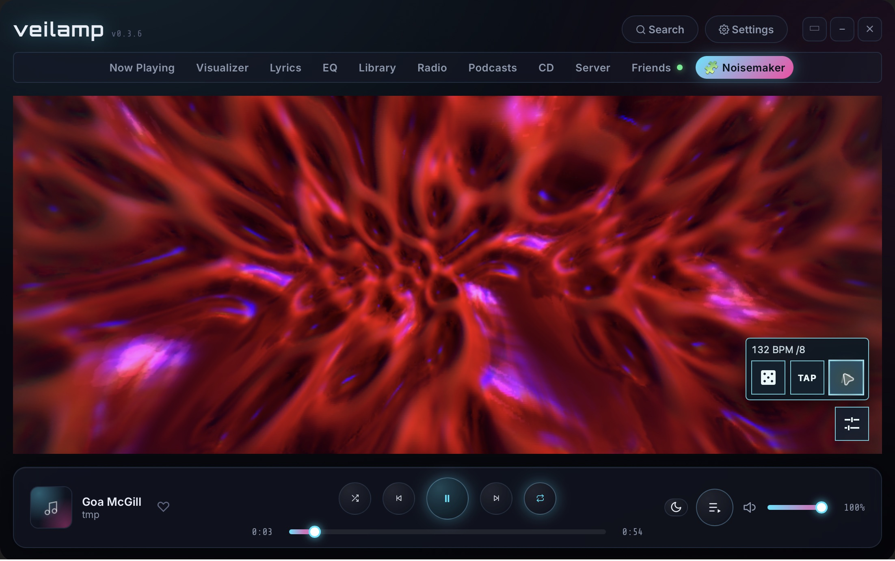

# Noisemaker for Veilamp



[MIT License](LICENSE) · [Noise Factor](https://noisefactor.io)

A generative audio visualizer for [Veilamp](https://veilamp.com/).
The plugin uses the [Noisemaker](https://github.com/noisefactorllc/noisemaker) shader engine.
It uses programs from [Noisemaker Curated](https://github.com/noisefactorllc/noisemaker-curated).

## Build

### Requirements

- Install Veilamp.
- Install Node.js 22 or later, with npm.
- Use Git if you want to clone this repository.
- Connect to the internet to install dependencies and build the plugin.

The installed plugin runs without network requests in standard Veilamp.
You do not need a GitHub account to download the source or build the plugin.

### Download the source

With Git, run these commands in a terminal:

```sh
git clone https://github.com/aayars/noisemaker-for-veilamp.git
cd noisemaker-for-veilamp
```

Without Git:

1. Open this repository's GitHub page.
2. Select Code > Download ZIP.
3. Extract the ZIP file.
4. Open a terminal in the extracted repository folder.

Run all commands below in the repository folder that contains `package.json` and `package-lock.json`.

### Build the plugin

1. Check the Node.js and npm versions:

   ```sh
   node --version
   npm --version
   ```

   The Node.js version must be `v22` or later.

2. Install the dependencies from the lockfile:

   ```sh
   npm ci
   ```

   This command downloads build and test tools into `node_modules/`.

3. Build the plugin:

   ```sh
   npm run build
   ```

   Each build downloads the current Noisemaker 1.x engine, required shaders, and current curated collection.
   The build checks program and custom shader hashes before it creates the output.

4. Check that the command finishes without an error.

   A successful build prints a message that starts with `Built dist/plugin:`.
   The message includes the entry size, program count, and stock effect count.

5. Check the generated `dist/plugin` folder.

   ```text
   dist/plugin/
     plugin.json
     index.js
     LICENSE
     NOISEMAKER-LICENSE
     CURATED-LICENSE
     sources.json
   ```

   `index.js` contains the engine, shaders, and programs.
   `sources.json` records the source versions, revisions, and hashes.
   The other license files contain the included sources' MIT notices.

If the build fails, correct the reported error before you import the plugin.
A failed build can leave output from an earlier build in `dist/plugin`.

## Install

1. Open Veilamp.
2. Select Settings > Plugins.
3. Select Import folder.
4. Select the generated `dist/plugin` folder.
5. Review the requested permissions.
6. Grant the permissions listed below.
7. Enable the Noisemaker plugin.
8. Open the Noisemaker tab.
9. Play audio in Veilamp.

Select `dist/plugin` itself, which contains `plugin.json` and the built `index.js`.
The repository's `plugin/` folder contains source files. It does not contain the bundled engine, shaders, or programs.
Keep all files in `dist/plugin` together when you copy the plugin to another computer.
That computer does not need Node.js or npm to use the built plugin.

| Permission | Use |
| --- | --- |
| `visualizer` | Supplies spectrum and waveform samples for audio response. |
| `player` | Supplies playback state for pause and track changes. |
| `panel` | Provides the Noisemaker tab. |

The plugin does not call player controls or request library access.
If you deny `player`, audio response remains available. Track changes and pause detection require that permission.

### Optional theme

The Noisemaker theme lets Veilamp navigation wrap to fit the window.

1. Select Settings > Appearance > Import theme.
2. Select `skin.json` from the repository folder.
3. Select the Noisemaker theme.

### Update the plugin

1. Download the latest repository source.

   For a Git clone with no local changes, run `git pull --rebase` from the repository folder.
   For a ZIP download, download and extract the latest ZIP file.

2. Run `npm ci` from the repository folder.
3. Run `npm run build` from the repository folder.
4. Check that the build succeeds.
5. Import the new `dist/plugin` folder through Settings > Plugins > Import folder.
6. Enable the Noisemaker plugin.

Every build checks the current engine release and collection revision.
You can also rebuild your existing source to update only the acquired engine, shaders, and collection.
Veilamp does not receive those updates until you import the new build.

### Build and install problems

| Problem | Action |
| --- | --- |
| The terminal cannot find `node` or `npm`. | Install Node.js with npm. Open a new terminal. Check both versions again. |
| npm cannot find `package.json` or the lockfile. | Run the commands from the repository folder. |
| A download fails. | Check your internet connection. Check the URL in the error. Run the build again after access returns. |
| A hash check fails. | Stop the installation. Run the build again to download the sources again. Do not change the expected hash. |
| The entry exceeds 4 MiB. | Stop the installation. Veilamp cannot import that build within its entry limit. |
| `dist/plugin` does not exist. | Run `npm ci`, then `npm run build`. Check that the build succeeds. |
| The panel says to build the plugin before import. | Import the generated `dist/plugin` folder. The source `plugin/` folder cannot run alone. |
| The visuals do not respond to audio. | Play audio in Veilamp. Check that the plugin has the `visualizer` permission. |
| Pause or track changes have no effect. | Check that the plugin has the `player` permission. |

## Controls

Open the control tray with the button at the lower right.

| Button | Action |
| --- | --- |
| Dice | Select another program and randomize its audio inputs. |
| TAP | Tap repeatedly to set the tempo. |
| Divider | Tap to cycle through /1, /2, /4, /8, and /16. |
| Info | Show or hide the composition name, author, and code. Off by default. |

The tempo starts at 140 BPM. The divider starts at /4.
The tray shows the current BPM and divider.
The loop duration is four beats multiplied by the divider.
For example, /4 gives a loop of 16 beats.
The keyboard shortcuts are R for randomize, T for tempo, and Escape to close the tray.
The shortcuts apply when the plugin has focus.

Composition information is hidden by default. Enable Info in the tray to show it.
When enabled, the title, author, and program code fade after a short delay.
A track change selects another program when Veilamp grants playback access.
The canvas uses half its normal pixel density when its width or height exceeds 1024 pixels.

## Programs and audio

The randomizer selects a generative program from the bundled curated collection.
The build includes custom shader definitions where required.
The build rejects programs that require images, media, camera, video, or MIDI.
It replaces up to four numeric runtime parameters with Noisemaker `audio()` inputs.
Programs with one available numeric parameter receive one input.
The audio bounds stay within 0–1. Noisemaker scales them to each parameter's range.
The randomizer forces `aspectLens: false` on every effect with the “1:1 aspect” control.
This applies to explicit values and omitted defaults, so lens effects use the canvas aspect ratio.

Veilamp sends 32 spectrum bands and a mono waveform.
The plugin maps these samples to low, mid, high, volume, spectrum, and waveform values in Noisemaker.
The shader parameters read these values through `audio()`.
Pause clears the audio values. The program's timed animation can continue.

## Build contents and sources

Each build downloads the current Noisemaker 1.x release from `shaders.noisedeck.app/1` and the current `main` commit of Noisemaker Curated.
It checks the program and custom shader SHA-256 hashes before bundling them.
The generated entry contains the runtime, shader manifest, required stock effects, custom shaders, and DSL programs.
It must fit Veilamp's 4 MiB entry-script limit.

The build records the acquired source revisions and hashes in `dist/plugin/sources.json`.
Git ignores downloads in `.build/` and generated files in `dist/`.
Do not commit the acquired engine, shaders, or collection.

Included sources:

- [Noisemaker](https://github.com/noisefactorllc/noisemaker): browser runtime and stock shaders, MIT, Noise Factor LLC.
- [Noisemaker Curated](https://github.com/noisefactorllc/noisemaker-curated): selected DSL programs and custom shaders, MIT, Noise Factor LLC. Programs are by Alex Ayars and Jess Hewitt.
- [Noiseblaster](https://blaster.noisedeck.app/) and [Visualize](https://github.com/noisefactorllc/visualize) supplied the collection's original and curated program versions.

The generated plugin includes the Noisemaker and collection license notices.

## Network and privacy

The installed plugin makes no network requests. Its entry script blocks network access within the plugin document.
It uses Veilamp audio samples locally for Noisemaker `audio()` inputs.
It uses playback identifiers and radio or CD metadata locally to detect track changes.

Only the build downloads content, from the Noisemaker shader CDN and GitHub.
Build requests do not include Veilamp audio samples, track titles, artist names, library files, or account identifiers.
The receiving services may see connection metadata, such as the client's IP address and user agent.

The plugin does not store logs.
If a program fails, it calls Veilamp's plugin logging API with the public program code and error.
If startup fails, it logs the error.
On Noise Factor's side, we keep basic server logs no longer than 7 days, to aid with troubleshooting.

## Check

Use Node.js 22 or later:

```sh
npm run check
npm test
```

The tests check program selection, audio bounds, event permissions, pause, tempo, divider, captions, and canvas dimensions.
Unit tests use a test renderer.
To check the built entry with real WebGL, install Playwright's Chromium browser:

```sh
npx playwright install chromium
```

On Linux, use `npx playwright install --with-deps chromium` to install Chromium and its system dependencies.
Then run:

```sh
npm run test:render
```

Run `npm run build` before the render check.
The render check uses a headless browser and blocks runtime network requests.
It checks shader pixels, audio-driven uniforms, captions, and repeated randomization.

## License and attribution

Copyright (c) 2026 Noise Factor LLC.
The repository code uses the [MIT License](LICENSE).
The [Trademark Policy](TRADEMARK.md) covers use of the Noisemaker and Noise Factor names.
